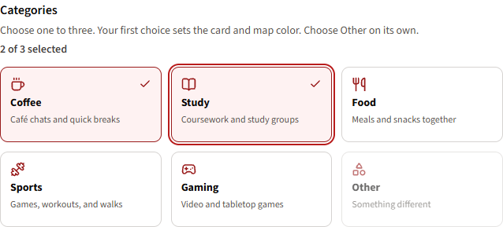

# 🐦 Martlet

### Find your flock. Make campus yours.

**A student-built social hub for spontaneous meetups, campus discoveries, and everyday life at McGill.**

[**🌐 Explore Martlet**](https://martlet-brown.vercel.app/) · [**🗺️ Explore the map**](https://martlet-brown.vercel.app/explore) · [**📖 Student guide**](https://martlet-brown.vercel.app/guide) · [**🐛 Report an issue**](https://github.com/DongtaiHuang/Martlet/issues)

**Next.js 16** · **React 19** · **TypeScript** · **Supabase** · **Tailwind CSS 4** · **MapLibre** · **Vercel**

Campus photograph by D. Benjamin Miller, CC0 1.0. See [photo credits](components/feed/hero/README.md).

---

## What is Martlet?

College life happens *between* classes: an impromptu coffee, a study session before an exam, a pickup game, or discovering a place on campus you've never visited.

**McGill Martlet** turns those small opportunities into ways to meet people. Discover nearby activities, host your own meetup, explore Montréal through landmark photo challenges, and take part in a student community—all from one web app.

Martlet is an **independent student project**, not an official McGill University service.

> **Try it:** [martlet-brown.vercel.app](https://martlet-brown.vercel.app/)  
> Visitors can browse parts of Martlet without an account. Posting, joining, liking, and unlocking landmarks require a signed-in student account.

## How it works

| Step | What you do | What happens |
| :--: | --- | --- |
| **1** | **Discover** | Browse upcoming meetups on the [feed](https://martlet-brown.vercel.app/meetups) or find them geographically on [Explore](https://martlet-brown.vercel.app/explore). |
| **2** | **Pick your thing** | Filter by Coffee, Study, Food, Sports, Gaming, or Other. Meetups can belong to up to **three categories**. |
| **3** | **Peck or Flap** | **Peck** means *I'm going*; **Flap** means *I like this*. Join other students' plans or show support. |
| **4** | **Host something** | Choose a time and meeting place, add details, and publish your own meetup. Organizers can edit or cancel eligible upcoming meetups. |
| **5** | **Explore & collect** | Visit landmark challenges, upload your photo to unlock others' shared memories, and grow your Martlet progress tree. |

### ☕ Example: start a Coffee + Study meetup

Imagine you have a gap between lectures and want to meet people before revising for an exam.

1. Open **Create Meetup** and enter a title such as *Coffee + COMP 302 review*.
2. Choose **Coffee** and **Study** together. If it's a Study meetup, you can associate a McGill course.
3. Pick an approved campus building (with a photo and map preview), or choose **Other** and type a public meeting spot.
4. Set a future date and time, then publish.
5. Classmates can discover the meetup, **Peck** to join, and **Flap** to like it. The host can update its details before it starts.

Multi-category meetup creation on desktop. [Mobile view](docs/screenshots/meetup-categories/mobile.png).

## Explore the features

### 📅 Meetups: make plans in minutes

- **Create and discover** spontaneous student meetups across six categories.
- **Mix categories:** up to three per event (for example, Coffee + Study or Food + Gaming); Other is selected on its own.
- **Choose a place:** use the McGill campus location catalog or enter a custom off-campus meeting place. Text-only locations are not given an inaccurate map pin.
- **Join and react:** Peck/unpeck to attend or leave; Flap/unflap to like or unlike.
- **Stay flexible:** hosts can edit eligible upcoming meetups and cancel their own plans.
- **Study together:** link Study meetups to courses and filter for your courses.

**Explore:** [Meetup feed](https://martlet-brown.vercel.app/meetups) · [Create a meetup](https://martlet-brown.vercel.app/meetups/new)

### 🗺️ Explore: a campus map with a social layer

Discover meetups and landmark challenges using an interactive map. Toggle layers, filter meetups by category, inspect markers, and open the relevant details. Campus places have map coordinates; custom text-only meeting locations remain accessible in a separate list.

The map uses **MapLibre GL JS**, with **OpenFreeMap** styles by default and optional Google Maps integration for supported location previews.

**Explore:** [Campus map](https://martlet-brown.vercel.app/explore)

### 📸 Landmarks: go there, snap it, unlock it

McGill and Montréal become a collection of photo challenges:

- Find a landmark and see its challenge.
- Visit the place and upload your own photo to unlock its community gallery.
- Browse shared photos in an immersive viewer, including zoom controls.
- Replace your own uploaded photo using the existing upload flow.
- Track unlocked landmarks through the **growing Martlet tree** and achievements.

Some gallery interactions include an optional shake-to-reveal effect on supported devices.

**Explore:** [Landmarks](https://martlet-brown.vercel.app/landmarks) · [Progress tree](https://martlet-brown.vercel.app/progress)

### 💬 Campus Board: the student conversation

A space for the things students actually talk about:

| Board type | What it's for |
| --- | --- |
| **Memes** 😂 | Campus humor and images |
| **Tips** 💡 | Share useful advice |
| **Q&A** ❓ | Ask questions, discuss answers, and mark a helpful answer |
| **Skills** 🛠️ | Share skills or offer freelance help |

Posts support community votes and comments. Signed-in users can report content; moderation tools help handle abuse. **Skill listings are not an in-app payment or marketplace checkout system.**

**Explore:** [Campus Board](https://martlet-brown.vercel.app/board)

### 🌱 Make Martlet your own

- **Student profile:** display name, course preferences, hosted and joined meetups, and activity history.
- **Achievements:** discover badges earned through exploration and engagement.
- **Your Martlet:** customize a 3D bird avatar; some accessories and colors unlock as you participate. Optional camera-based expression tracking is supported.
- **Martlet Flight:** a casual flap-to-fly mini-game with a leaderboard for signed-in players.
- **Personalization:** theme choices, seasonal styling, and playful campus animations.
- **Campus extras:** trending topics, a daily quote and joke, a searchable student guide, and links to McGill News.

**Explore:** [Profile](https://martlet-brown.vercel.app/profile) · [Achievements](https://martlet-brown.vercel.app/achievements) · [Avatar](https://martlet-brown.vercel.app/avatar) · [Martlet Flight](https://martlet-brown.vercel.app/play) · [Student guide](https://martlet-brown.vercel.app/guide) · [McGill News](https://martlet-brown.vercel.app/news)

## Guest browsing vs. student accounts

| Action | Guest | Signed-in student |
| --- | :---: | :---: |
| Browse public meetup summaries and maps | ✅ | ✅ |
| Browse the landmark catalog | ✅ | ✅ |
| Play Martlet Flight | ✅ | ✅ |
| Create/edit meetups | — | ✅ |
| Peck and Flap | — | ✅ |
| Upload landmark photos and unlock galleries | — | ✅ |
| Post and interact on Campus Board | — | ✅ |
| Save account-linked progress and leaderboard scores | — | ✅ |

For privacy, guest meetup summaries are limited and custom meeting instructions may require signing in. Landmark community photos are not public to guests.

## Tech stack

| Layer | Technology | Role |
| --- | --- | --- |
| **Web app** | Next.js 16 App Router, React 19, TypeScript | Pages, components, Server Actions, application logic |
| **UI** | Tailwind CSS 4, Lucide React | Responsive layouts, themes, and interface elements |
| **Backend & identity** | Supabase (PostgreSQL, Auth, Storage, RLS) | Accounts, meetups, interactions, landmark photos, community content |
| **Mapping** | MapLibre GL JS / OpenFreeMap; optional Google Maps | Maps, markers, and place previews |
| **Interactive experiences** | Three.js, React Three Fiber, MediaPipe | Avatar and camera-based interaction |
| **Deployment** | Vercel; Docker option | Public Next.js hosting and alternative container builds |

### Project structure

\`\`\`text
app/             Next.js routes (meetups, explore, landmarks, board, profile, ...)
components/      Reusable UI: feed, forms, maps, social, landmarks, avatar, game
lib/             Supabase services, validation, business logic, shared utilities
types/           Shared TypeScript contracts
supabase/        SQL migrations, database tests, verification helpers
docs/            Deployment, setup, ADRs, team notes, screenshots
tests/           Unit, browser, and SQL regression checks
public/          Public assets
\`\`\`

### How the pieces fit together

A visitor opens a Next.js page. Server-side services fetch the content that user is allowed to see from Supabase. Signed-in actions (create, edit, Peck, Flap, upload, and post) are validated on the server and checked against database permissions. Maps and interactive experiences run in the browser. Vercel hosts the web application; Supabase stores persistent app data.

## Run locally

**Requirements:** Node.js **22.13+ (22.x)**, npm, and an internet connection for map tiles.

\`\`\`bash
git clone https://github.com/DongtaiHuang/Martlet.git
cd Martlet
npm ci
cp .env.example .env.local
npm run dev
\`\`\`

Windows PowerShell equivalent for the copy step:

\`\`\`powershell
Copy-Item .env.example .env.local
\`\`\`

Open **http://localhost:3000**.

### Demo mode vs. live data

Without Supabase credentials, Martlet runs in **mock/demo mode**: you can explore sample meetups and parts of the interface, but account-based writes are disabled.

For a live local Supabase project, fill in the following values in **.env.local**:

\`\`\`env
NEXT_PUBLIC_SUPABASE_URL=https://YOUR-PROJECT.supabase.co
NEXT_PUBLIC_SUPABASE_PUBLISHABLE_KEY=YOUR-PUBLISHABLE-KEY
\`\`\`

Then restart the development server. The database also requires the applicable migrations, grants, RLS policies, and Storage configuration; adding keys alone does not initialize the schema.

MapLibre uses OpenFreeMap by default. Optional mapping settings include \`NEXT_PUBLIC_MAP_STYLE_URL\`, \`NEXT_PUBLIC_MAP_STYLE_URL_DARK\`, \`NEXT_PUBLIC_GOOGLE_MAPS_API_KEY\`, and \`NEXT_PUBLIC_GOOGLE_MAP_ID\`.

**Never commit \`.env.local\`, passwords, database credentials, or Supabase secret/service-role keys.**

For setup details, see [Supabase setup](docs/SUPABASE_SETUP.md).

### Quality checks

\`\`\`bash
npx tsc --noEmit
npm run lint
npm run check:contrast
npm run build
\`\`\`

Additional targeted browser and SQL tests live in [tests/](tests/). Database tests require an authorized test environment.

## Deploying & releases

The production deployment uses [Vercel](https://vercel.com/) with the \`main\` branch. Configure the appropriate Supabase environment variables and callback URLs for your production domain before enabling live sign-in.

- [Deployment and rollback guide](docs/DEPLOYMENT.md)
- [Supabase configuration and migration guide](docs/SUPABASE_SETUP.md)
- [Release and Docker notes](docs/RELEASES.md)
- [Architecture decisions](docs/adr/README.md)

## Contributing

Martlet was developed collaboratively by a student team. Contributions, UI improvements, bug reports, and suggestions are welcome through [GitHub Issues](https://github.com/DongtaiHuang/Martlet/issues).

For code changes: branch from the latest \`main\`, keep PRs focused, run the project checks, and open a pull request for review. Please do not commit private environment files or user data.

## Project status & notes

Martlet is an actively developed student project. Features requiring authentication, storage, database migrations, or optional third-party services depend on the deployment's configuration. If something doesn't work, please open an [issue](https://github.com/DongtaiHuang/Martlet/issues) with the page, expected behavior, and steps to reproduce—without sharing private information.

**Photo credits:** Campus carousel photography is sourced from Wikimedia Commons under CC0 1.0; full attributions are in [the image credits](components/feed/hero/README.md). Other images and uploaded landmark photos belong to their respective creators.

---

**Built by students, for students in Montréal.** ❤️

[**Visit Martlet**](https://martlet-brown.vercel.app/) · [**Browse the source**](https://github.com/DongtaiHuang/Martlet) · [**Share feedback**](https://github.com/DongtaiHuang/Martlet/issues)

McGill Martlet is an independent student project and is not affiliated with or endorsed by McGill University.

