# Martlet crash course

A guided tour of how McGill Martlet works, written for **non-developers** (designers, PMs, judges, teammates new to code) and **beginner developers**. You don't need to know any programming to read Parts 1–3. Parts 4–7 go file by file and function by function.

> **Status:** written against `main` plus [PR #23](https://github.com/DongtaiHuang/Martlet/pull/23) (Peck/Flap on feed cards, profile with hosted/joined meetups). The display-name form (`app/profile/actions.ts`, `components/profile/DisplayNameForm.tsx`) is still in progress and not merged yet.

> **How to read the diagrams:** they're written in [Mermaid](https://mermaid.js.org). GitHub, VS Code (with a Mermaid extension) and most Markdown viewers draw them as pictures automatically.

**Contents**

1. [What Martlet is, in plain English](#1-what-martlet-is-in-plain-english)
2. [Glossary: words you'll see everywhere](#2-glossary-words-youll-see-everywhere)
3. [The tech stack and why each piece is there](#3-the-tech-stack-and-why-each-piece-is-there)
4. [The big picture: how a page reaches your phone](#4-the-big-picture-how-a-page-reaches-your-phone)
5. [The user journeys, step by step](#5-the-user-journeys-step-by-step)
6. [The database and security](#6-the-database-and-security)
7. [File-by-file reference](#7-file-by-file-reference)
8. [Running, checking and changing the project](#8-running-checking-and-changing-the-project)
9. [Learning path and FAQ](#9-learning-path-and-faq)

---

## 1. What Martlet is, in plain English

Martlet is a website for McGill students to organise **spontaneous meetups** on campus: "coffee at Redpath in 20 minutes", "COMP 251 study group at Trottier tonight".

A student can:

| Action | Martlet word | What it means |
| --- | --- | --- |
| Post a meetup | **Create** | Pick a title, category, approved campus building and start time. |
| Join a meetup | **Peck** | "I'm going." Un-peck to leave. |
| Like a meetup | **Flap** | A lightweight "this looks cool". Un-flap to remove it. |
| Cancel a meetup | **Cancel** | Only the person who created it (the **host**) can do this. |
| Browse | **Feed** / **Explore** | A list of upcoming meetups, or the same meetups as pins on a campus map. |

Three rules shape everything in the code:

1. **Only approved campus places.** Meetups can only happen at a fixed list of McGill buildings. Nobody can type in their dorm address.
2. **Your location stays on your phone.** The map's "show my location" button draws a dot for you only. It's never sent to the server.
3. **The database is the bouncer.** Even if someone bypasses the website and talks to the database directly, the database itself refuses anything they're not allowed to do.

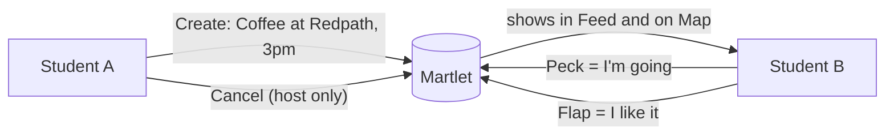

---

## 2. Glossary: words you'll see everywhere

| Term | Plain-English meaning |
| --- | --- |
| **Frontend / client / browser** | The part that runs on the student's phone or laptop: what you see and tap. |
| **Backend / server** | The computer (here, Vercel) that builds pages and talks to the database. Students never see its code. |
| **Database** | Where data lives permanently: users, meetups, pecks, flaps. Ours is PostgreSQL, hosted by Supabase. |
| **Route / page** | A URL like `/meetups` or `/explore`. Each one maps to a file in `app/`. |
| **Component** | A reusable building block of the screen, like a meetup card or a button. Lives in `components/`. |
| **Function** | A named piece of code that does one job, e.g. `listMeetups()` fetches upcoming meetups. |
| **Type** | A description of the *shape* of data ("a meetup has a title, which is text"). Catches mistakes before the code runs. |
| **Server Component** | A component that runs **on the server**. It can read the database safely. Default in this project. |
| **Client Component** | A component that runs **in the browser** so it can react to taps. Marked with `"use client"` at the top of the file. |
| **Server Action** | A function that runs on the server but can be called by a button or form in the browser. Marked with `"use server"`. |
| **Session / cookie** | How the site remembers you're signed in. A small signed ticket the browser sends with every request. |
| **RLS (Row-Level Security)** | Rules inside the database that decide which rows each user may read or change. Our real security. |
| **Migration** | A SQL file that changes the database's structure. Run in order, never edited after teammates apply them. |
| **Mock mode / live mode** | Mock = fake sample data, no database needed. Live = real Supabase database. |
| **Environment variable (env var)** | A setting passed to the app from outside the code, like the database address. Kept in `.env.local`, never committed. |
| **ADR** | Architecture Decision Record: a short doc explaining *why* we chose something. In `docs/adr/`. |
| **CI** | Continuous Integration: GitHub automatically checks every pull request (types, lint, build). |

---

## 3. The tech stack and why each piece is there

| Technology | Role | Analogy | Where you see it |
| --- | --- | --- | --- |
| **Next.js 16** (App Router) | The web framework. Turns files in `app/` into pages, runs code on the server. | The building's floor plan and plumbing. | `app/`, `proxy.ts`, `next.config.ts` |
| **React 19** | Library for building the UI out of components. | Lego bricks for screens. | Every `.tsx` file |
| **TypeScript** | JavaScript plus types. Catches typos and wrong data shapes before running. | Spell-check for code. | Every `.ts` / `.tsx` file, `types/meetup.ts` |
| **Tailwind CSS v4** | Styling via short class names (`rounded-xl bg-red-800`). | Paint and furniture. | `className="..."` everywhere, `app/globals.css` |
| **Supabase** | Hosted PostgreSQL database + user accounts (Auth). | The filing cabinet and the ID-card office. | `lib/supabase/`, `supabase/migrations/` |
| **PostgreSQL + RLS** | The actual database and its security rules. | The cabinet's locks. | `supabase/migrations/*.sql` |
| **MapLibre GL JS** | Draws the interactive campus map in the browser. | The campus map on the wall. | `components/map/` |
| **OpenFreeMap** | Free map tiles (the streets and buildings images). | The printed map paper. | `components/map/map-style.ts` |
| **Zod** | Checks that incoming form data is valid. | The form checker at the front desk. | `lib/meetup-validation.ts`, `*/actions.ts` |
| **lucide-react** | Icon set (coffee cup, map pin, heart). | Stickers. | `import { Coffee } from "lucide-react"` |
| **Vercel** | Hosts the live website. | The landlord. | `docs/DEPLOYMENT.md` |
| **GitHub Actions** | Runs checks on every pull request. | A building inspector. | `.github/workflows/ci.yml` |

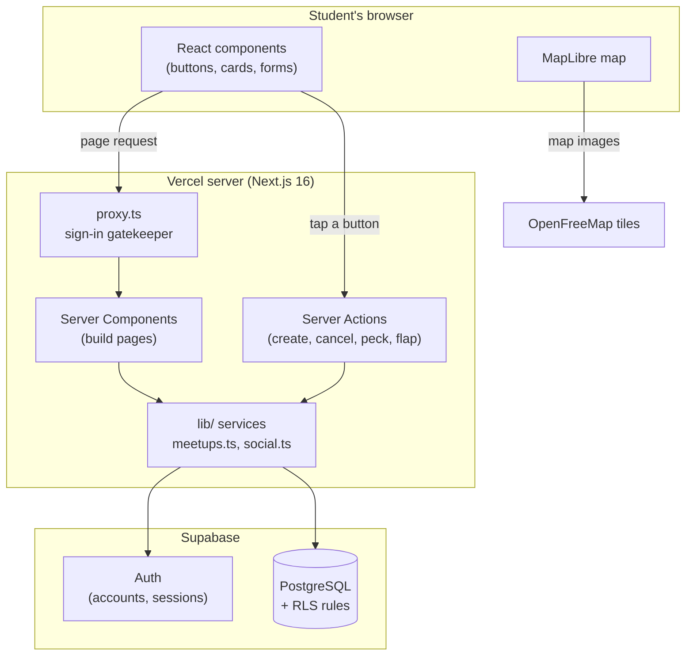

---

## 4. The big picture: how a page reaches your phone

### 4.1 The two modes: mock and live

The app runs in exactly **one** mode, decided at startup by whether the Supabase settings exist. This lets anyone run the app with zero setup.

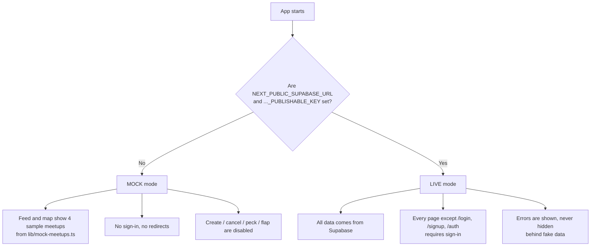

The decision lives in one tiny function, `getDataMode()` in `lib/supabase/env.ts`.

### 4.2 The life of a request

What happens when a signed-in student opens `/meetups`:

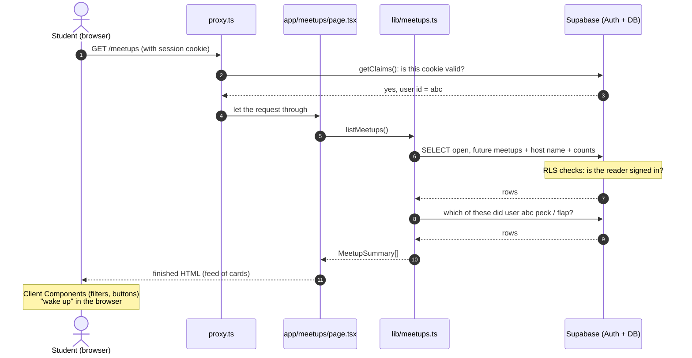

If the cookie is missing or expired, step 3 fails and `proxy.ts` sends the student to `/login?next=/meetups`, so after signing in they land back where they started.

### 4.3 Folder map

```text
Martlet/
├── app/                  Pages (each folder = a URL) and Server Actions
│   ├── layout.tsx        Wraps every page (<html>, global CSS)
│   ├── page.tsx          "/"  → redirects to /meetups
│   ├── meetups/          "/meetups" feed, "/meetups/new" create, "/meetups/[id]" detail
│   ├── explore/          "/explore" campus map
│   ├── profile/          "/profile" your info + your meetups
│   ├── login/ signup/    sign-in and sign-up pages
│   └── auth/             sign-in actions + email confirmation link handler
├── components/           Reusable UI pieces
│   ├── auth/             sign-in form, "signed in as…" bar, sign-out button
│   ├── feed/             meetup card, feed with filters, category colours/icons
│   ├── forms/            create form, cancel form, loading/error screens
│   ├── layout/           top navigation bar
│   ├── map/              Explore map, small detail-page map, map settings
│   ├── profile/          change display name form
│   └── social/           Peck and Flap buttons
├── lib/                  "Services": the logic that isn't UI
│   ├── meetups.ts        list / get / create / cancel meetups
│   ├── social.ts         peck / unpeck / flap / unflap
│   ├── meetup-validation.ts   rules for a valid meetup
│   ├── locations.ts      the approved campus buildings
│   ├── mock-meetups.ts   sample data for mock mode
│   └── supabase/         how we connect to Supabase + who is signed in
├── types/meetup.ts       The shared "shape" of a meetup
├── supabase/             Database: migrations (SQL), seed and verify scripts
├── proxy.ts              Runs before every page: refreshes session, enforces sign-in
├── scripts/              Small build helpers
├── docs/                 You are here. Plans, contracts, ADRs, setup guides
└── public/               Static files served as-is
```

### 4.4 How the layers talk to each other

There's one strict rule (from `AGENTS.md`): **components call `lib/` services, never Supabase directly.** This keeps all database logic in one place.

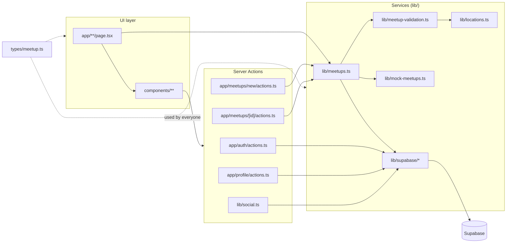

---

## 5. The user journeys, step by step

### 5.1 Sign up and sign in

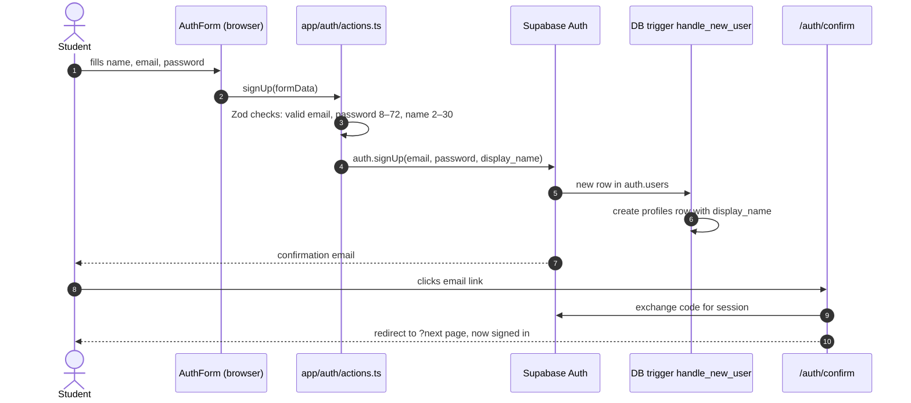

Sign-in is simpler: `signIn()` checks the form, calls `supabase.auth.signInWithPassword`, then redirects to the safe `next` path. `safeRedirectPath()` makes sure `next` is a path on *our* site, so a malicious link can't bounce users to another website.

### 5.2 Browsing the feed

1. `app/meetups/page.tsx` shows the banner instantly, and a "Loading meetups…" skeleton while the data loads (React `Suspense`).
2. If live and signed out, it shows "Sign in to see meetups" instead of an empty list.
3. Otherwise it calls `listMeetups()`, keeps only open future meetups, sorts by start time.
4. `MeetupFeed` (browser) shows category filter chips. Filtering happens in the browser, no extra server call.
5. Each `MeetupCard` shows the time in the student's own timezone, plus Peck/Flap buttons if signed in.

### 5.3 Creating a meetup

The data is checked **three times**: in the form action, in the service, and in the database. Each layer catches what the one before might miss.

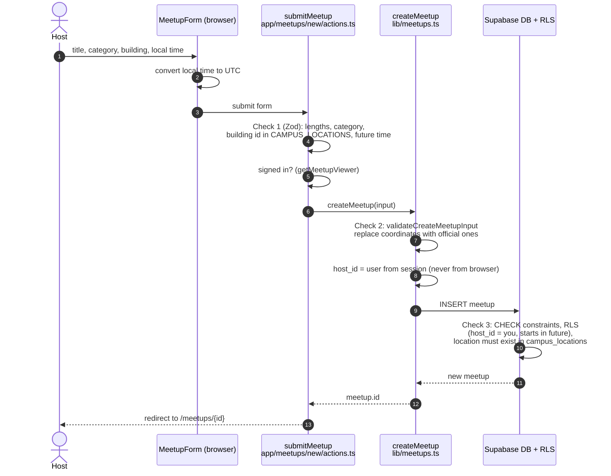

### 5.4 Peck and Flap

The buttons are **optimistic**: they update the number on screen immediately, then confirm with the server. If the server says no, they roll back and show an error.

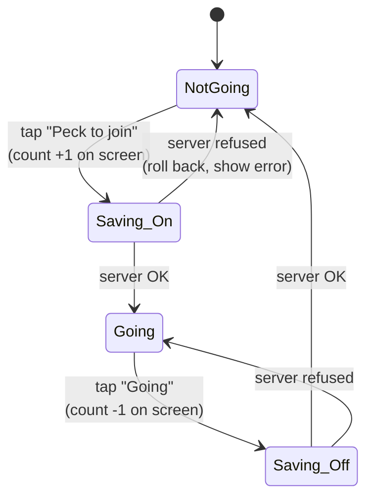

On the server (`lib/social.ts`), a peck is just "insert a row into `meetup_pecks`". The database refuses if:

- the meetup is cancelled or already started,
- you're the host (hosts are counted automatically),
- you're trying to peck as someone else.

Double-tapping is harmless: the table only allows one row per (meetup, user), and the duplicate error is ignored.

**Counting:** `attendee_count = 1 (the host) + number of pecks`. `flap_count = number of flaps`.

### 5.5 Cancelling a meetup

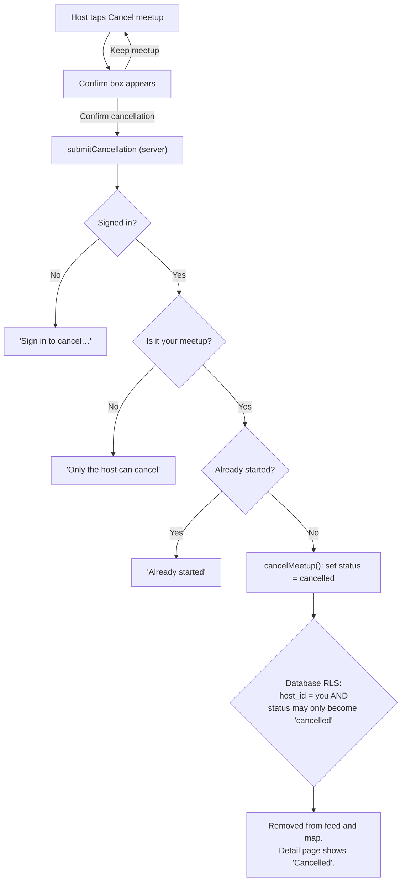

Cancelling never deletes anything. It's a "soft" change of `status` from `open` to `cancelled`.

### 5.6 Explore map

1. `app/explore/page.tsx` calls the same `listMeetups()` as the feed, so the map and feed always agree.
2. `CampusMap` (browser) creates a MapLibre map centred on campus and drops a coloured pin per meetup.
3. Tapping a pin opens a popup built safely with `textContent` (so a meetup titled `<script>` shows as text, not code).
4. A link like `/explore?meetup=<id>` (from the detail page) zooms to that meetup and opens its popup.
5. The 📍 "show my location" button asks the browser for your position **only when tapped**, shows a dot, and sends it nowhere (ADR 0008).

### 5.7 Profile

`app/profile/page.tsx` shows one of four states: *preview* (mock mode), *signed out*, *error*, or *ready*. When ready, it shows your name and email, a form to change your display name (`updateDisplayName` in `app/profile/actions.ts`), and two lists built from `listMeetups()`: meetups you're **hosting** and meetups you're **going** to.

---

## 6. The database and security

### 6.1 Tables

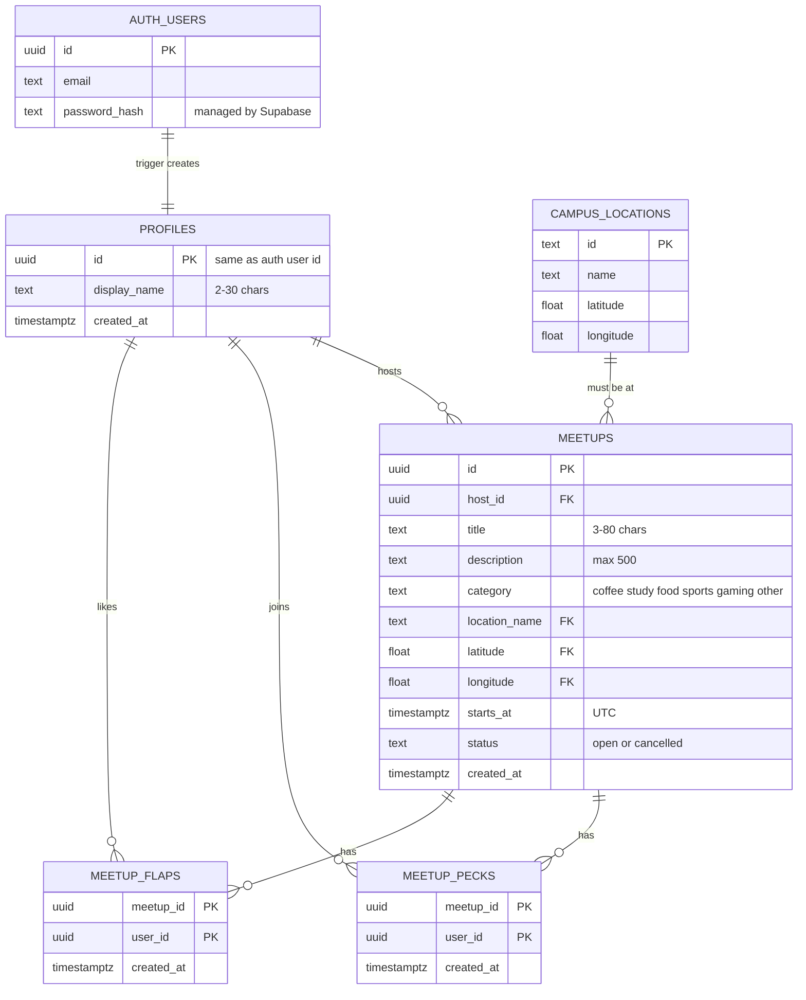

| Table | What it stores | Notes |
| --- | --- | --- |
| `auth.users` | Accounts (managed by Supabase, we don't touch it) | Passwords are never in our code. |
| `profiles` | Public info: display name | Created automatically by the `handle_new_user` trigger on sign-up. |
| `meetups` | Every meetup ever created | Cancelled ones stay, with `status = 'cancelled'`. |
| `meetup_pecks` | Who's going to what | Primary key `(meetup_id, user_id)` = max one peck each. |
| `meetup_flaps` | Who likes what | Same idea as pecks. |
| `campus_locations` | The approved buildings | Mirror of `lib/locations.ts`. A meetup's place must match a row here exactly. |

### 6.2 Migrations: the database's history

| File | What it does |
| --- | --- |
| `001_mvp.sql` | Creates the tables, the sign-up trigger, indexes, and the first RLS rules. Run once on a fresh project. |
| `002_security_hardening.sql` | Tightens rules: hosts can *only* cancel (not edit), clients can only write user-owned columns, adds `campus_locations` and forces meetups to use it, uses the sign-up display name. |
| `003_more_campus_locations.sql` | Adds 10 more buildings. |
| `004_backfill_profiles.sql` | Creates profiles for accounts made before the trigger existed. |
| `005_table_grants.sql` | Explicitly grants table permissions (newer Supabase projects don't do it automatically). |

**Rule:** never edit a migration someone already ran. Add a new numbered file instead.

### 6.3 Security in layers

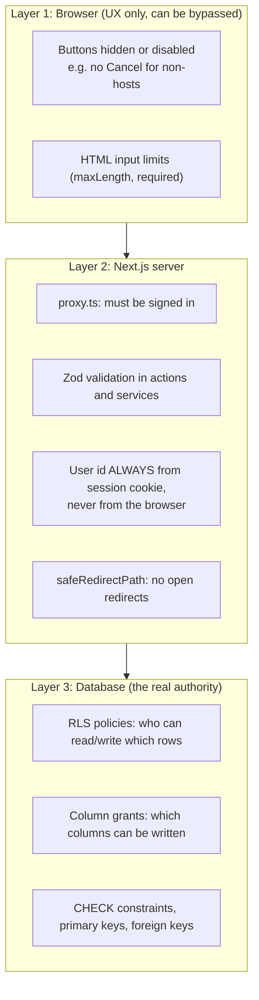

Why three layers? Layer 1 gives friendly messages. Layer 2 gives clear errors and keeps secrets off the browser. Layer 3 is the only one an attacker can't skip: Supabase's database is reachable directly with the public key, so **RLS must be correct on its own** (ADR 0003).

What RLS enforces, in plain English:

| Who | Can | Can't |
| --- | --- | --- |
| Signed-out visitor | Read the list of campus buildings | Read meetups, profiles, pecks or flaps. Write anything. |
| Any signed-in student | Read all meetups/profiles/pecks/flaps. Create a meetup **as themselves**, in the future, at an approved place. Peck/flap open future meetups. Remove their own pecks/flaps. Change their own display name. | Create a meetup as someone else. Peck their own meetup. Peck/flap cancelled or past meetups. Delete meetups. |
| The host | Cancel their own meetup | Edit title/time/place after creating. Re-open a cancelled meetup. |

**Secrets:** the app only ever uses the Supabase **publishable** key (safe to be public, RLS protects the data). The **service-role** key bypasses RLS and must never appear in this project.

---

## 7. File-by-file reference

Each entry: what the file is for, who runs it (🖥️ server, 🌐 browser, 🗄️ database, 🛠️ developer tool), and its main functions.

### 7.1 Shared contracts

**`types/meetup.ts`** 🖥️🌐: the shape of meetup data, used everywhere. Changing it affects every developer (`docs/CONTRACTS.md`).

| Type | Meaning |
| --- | --- |
| `MeetupCategory` | One of `coffee`, `study`, `food`, `sports`, `gaming`, `other`. |
| `MeetupStatus` | `open` or `cancelled`. |
| `Meetup` | One row of the `meetups` table. |
| `CreateMeetupInput` | Just the fields a host fills in (title, description, category, place, time). |
| `MeetupSummary` | A `Meetup` plus what the UI needs: host's name, `attendee_count`, `flap_count`, and whether *you* `has_pecked` / `has_flapped`. |

**`lib/locations.ts`** 🖥️🌐: the 14 approved buildings.

| Export | Does |
| --- | --- |
| `CAMPUS_LOCATIONS` | The list: id, name, latitude, longitude. Must match the `campus_locations` table. |
| `getCampusLocation(id)` | Finds a building by id, e.g. `"redpath-library"`. |

### 7.2 Services (`lib/`)

**`lib/meetups.ts`** 🖥️: the heart of the app. Server-only.

| Function | Does | Throws |
| --- | --- | --- |
| `listMeetups()` | Mock: sample data. Live: up to 100 open, future meetups, soonest first, with host names, counts and your reactions. Signed out → empty list. | Database errors |
| `getMeetup(id)` | One meetup by id, **including** cancelled/past (for the detail page). Returns `null` if not found or id isn't a valid UUID. | Database errors |
| `createMeetup(input)` | Validates, sets `host_id` from your session, inserts. Returns the new meetup. | `MockModeError`, `MeetupValidationError`, `AuthRequiredError` |
| `cancelMeetup(id)` | Sets `status = 'cancelled'` only where `host_id` is you. Cancelling twice is fine. | `MockModeError`, `AuthRequiredError`, `MeetupNotFoundError` |
| `getMeetupDataMode()` | Re-export of `getDataMode()`. | |
| *internal* `currentUserId`, `userReactions`, `toSummary`, `firstCount`, `hostName` | Helpers: who's signed in, which meetups you reacted to, turn a database row into a `MeetupSummary` (adds the +1 for the host). | |

Error classes: `MockModeError`, `MeetupValidationError` (carries `fieldErrors` per field), `MeetupNotFoundError`, `AuthRequiredError`.

**`lib/social.ts`** 🖥️ (Server Actions): Peck and Flap.

| Function | Does |
| --- | --- |
| `peck(id)` / `unpeck(id)` | Insert / delete your row in `meetup_pecks`. |
| `flap(id)` / `unflap(id)` | Insert / delete your row in `meetup_flaps`. |
| *internal* `getSession(id)` | Refuses in mock mode, checks the id is a UUID (sample meetups aren't), gets your user id from the session. |
| *internal* `add` / `remove` | Do the insert/delete. A duplicate insert (`23505`) is treated as success. |
| *internal* `refresh(id)` | Tells Next.js to rebuild `/meetups`, `/explore` and the detail page so counts update. |

**`lib/meetup-validation.ts`** 🖥️🌐: pure rules, no database.

| Export | Does |
| --- | --- |
| `MEETUP_CATEGORIES`, `TITLE_MIN` (3), `TITLE_MAX` (80), `DESCRIPTION_MAX` (500) | The limits. |
| `findApprovedLocation(name, lat, lng)` | Finds the approved building matching a name and coordinates (tiny tolerance for rounding). |
| `validateCreateMeetupInput(input, now?)` | Checks everything; returns `{ ok: true, value }` with the **official** coordinates swapped in, or `{ ok: false, errors }` per field. |

**`lib/mock-meetups.ts`** 🖥️: `getMockMeetups()` returns 4 fake meetups whose start times are always 20–150 minutes from "now".

### 7.3 Supabase connection (`lib/supabase/`)

| File | Function | Does |
| --- | --- | --- |
| `env.ts` | `getSupabaseConfig()` | Returns `{ url, key }` from env vars, or `null`. |
| | `getDataMode()` | `"live"` if config exists, else `"mock"`. |
| `server.ts` 🖥️ | `createClient()` | Supabase client that reads/writes the session **cookie**. Use on the server. |
| `client.ts` 🌐 | `createClient()` | Supabase client for the browser. (Currently unused: everything goes through the server.) |
| `auth.ts` 🖥️ | `getCurrentUser()` | Verifies the session and returns `{ id, email, display_name }`, or `null`. |
| | `requireUser()` | Same, but throws `AuthRequiredError` if signed out. |
| `redirect.ts` | `safeRedirectPath(value)` | Only allows paths like `/meetups`, never `//evil.com` or full URLs. Defaults to `/meetups`. |

### 7.4 Gatekeeper and config

| File | Does |
| --- | --- |
| `proxy.ts` 🖥️ | Runs before every page (Next.js 16 renamed "middleware" to "proxy"). In live mode: refreshes the session cookie, and if you're signed out on a non-public page, redirects to `/login?next=…`. Public: `/login`, `/signup`, `/auth/*`. Skips images and static files. |
| `next.config.ts` | Blocks production builds that use MapLibre's demo tiles. |
| `scripts/copy-maplibre-worker.mjs` 🛠️ | Before `dev`/`build`, copies MapLibre's helper file into `public/` so the map can load it. |
| `.env.example` | Template for `.env.local`: Supabase URL/key, optional map style, test-account logins for scripts. |
| `eslint.config.mjs`, `tsconfig.json`, `postcss.config.mjs` | Lint rules, TypeScript settings (`@/` means project root), Tailwind setup. |

### 7.5 Pages and actions (`app/`)

| File | URL | Kind | Does |
| --- | --- | --- | --- |
| `layout.tsx` | all | 🖥️ | Page title/description, `<html lang="en-CA">`, loads `globals.css`. |
| `page.tsx` | `/` | 🖥️ | Redirects to `/meetups`. |
| `meetups/page.tsx` | `/meetups` | 🖥️ | Banner, "Create" / "Explore" buttons, feed. Functions: `loadUpcomingMeetups()` (filter + sort, `null` on error), `UpcomingMeetups()` (sign-in prompt / error / preview notice / feed), `FeedLoading()` (skeleton). |
| `meetups/new/page.tsx` | `/meetups/new` | 🖥️ | Shows `MeetupForm`, plus a notice if in demo mode or signed out. |
| `meetups/new/actions.ts` | | 🖥️ action | `submitMeetup(prev, formData)`: Zod-validates, checks sign-in, calls `createMeetup`, refreshes feed/map, redirects to the new meetup. |
| `meetups/new/loading.tsx`, `error.tsx` | | 🖥️ / 🌐 | Loading skeleton and "try again" screen. |
| `meetups/[id]/page.tsx` | `/meetups/<id>` | 🖥️ | Detail view. `loadMeetup(id)` works out `cancelled`, `expired`, `upcoming`, `isHost`, `canCancel`, `canReact`. Shows host, time, place + mini map, description, Peck/Flap, Cancel. |
| `meetups/[id]/actions.ts` | | 🖥️ action | `submitCancellation(id, …)`: checks signed in, is host, not started; calls `cancelMeetup`; refreshes pages. |
| `meetups/[id]/MeetupReactions.tsx` | | 🖥️ | Shows "N going · M flaps" and, if allowed, the buttons. |
| `meetups/[id]/MeetupStartTime.tsx` | | 🌐 | Formats the start time in *your* timezone (server falls back to Montreal time). |
| `meetups/[id]/loading.tsx`, `error.tsx`, `not-found.tsx` | | | Loading, error and "Meetup not found" screens. |
| `explore/page.tsx` | `/explore` | 🖥️ | Loads meetups and passes them (and `?meetup=` focus) to `CampusMap`. |
| `profile/page.tsx` | `/profile` | 🖥️ | `loadProfile()` returns preview / signed-out / error / ready; `MeetupList` renders "Hosting" and "Going". |
| `profile/actions.ts` | | 🖥️ action | `updateDisplayName(prev, formData)`: validates 2–30 chars, updates your own profile row. |
| `login/page.tsx`, `signup/page.tsx` | `/login`, `/signup` | 🖥️ | Thin wrappers around `AuthPage`. |
| `auth/actions.ts` | | 🖥️ action | `signIn`, `signUp`, `signOut`. Each validates with Zod and refuses politely in mock mode. |
| `auth/confirm/route.ts` | `/auth/confirm` | 🖥️ route | Handles the email confirmation link (`?code=` or `?token_hash=&type=`), signs you in, redirects to `next`. |
| `globals.css` | | | Imports Tailwind and base styles. |

### 7.6 Components (`components/`)

**auth/**

| File | Kind | Does |
| --- | --- | --- |
| `AuthPage.tsx` | 🖥️ | Sign-in/up page shell: demo-mode notice, error from URL, or "Signed in as… Continue / Sign out" if already signed in. |
| `AuthForm.tsx` | 🌐 | The email/password (and name, for sign-up) form. Uses `useActionState` to show errors and "Please wait…". |
| `AuthStatus.tsx` | 🖥️ | The right side of the nav: "Demo mode", "Sign in / Sign up", or your name + Sign out. |
| `SignOutButton.tsx` | 🖥️ | A tiny form that calls `signOut`. |

**feed/**

| File | Kind | Does |
| --- | --- | --- |
| `MeetupFeed.tsx` | 🌐 | Category filter chips (`useState`), count, grid of cards, empty state. |
| `MeetupCard.tsx` | 🌐 | One meetup: category badge, "Hosting" / "You're going" badges, title, host, time (your timezone), place, Peck/Flap buttons or read-only counts, "View meetup" link. |
| `FeedUnavailable.tsx` | 🌐 | "Couldn't load meetups" with a **Try again** button (`router.refresh()`). |
| `categories.ts` | | Label, icon and colours per category; `categoryValues` list. |
| `campus-banner.webp`, `image-types.d.ts` | | Banner image and its TypeScript declaration. |

**forms/**

| File | Kind | Does |
| --- | --- | --- |
| `MeetupForm.tsx` | 🌐 | Create form. `handleSubmit` converts your local date/time to UTC before sending. `FieldError` shows per-field messages with accessible `aria-invalid`. |
| `CancelMeetupForm.tsx` | 🌐 | Two-step "Cancel meetup → Confirm cancellation" with pending and error states. |
| `MeetupRouteStatus.tsx` | 🖥️🌐 | Shared loading / error / not-found screen (uses a simplified nav since error screens run in the browser). |
| `meetup-viewer.ts` | 🖥️ | `getMeetupViewer()`: returns the signed-in user id, or `null`. |

**layout/**

| File | Kind | Does |
| --- | --- | --- |
| `MartletNav.tsx` | 🖥️ | Top bar: logo, links, `AuthStatus`. |
| `MartletNavLinks.tsx` | 🌐 | Feed / Explore / Create / Profile, highlighting the current page (`usePathname`). |

**map/**

| File | Kind | Does |
| --- | --- | --- |
| `CampusMap.tsx` | 🌐 | Explore map. Effects: (1) create map + zoom and "show my location" controls, (2) add a pin per visible meetup, (3) zoom to `focusId`. `popupContent()` builds popups safely. Category filter chips. |
| `MeetupLocationMap.tsx` | 🌐 | Small single-pin map on the detail page; scroll-zoom and rotate disabled so it doesn't hijack scrolling. |
| `map-config.ts` | 🌐 | Pin colours per category, campus centre, MapLibre worker location. |
| `map-style.ts` | | Which map style to use: `NEXT_PUBLIC_MAP_STYLE_URL` or OpenFreeMap (never demo tiles). |
| `explore-link.ts` | | `exploreMeetupHref(id)` → `/explore?meetup=<id>`. |

**profile/** · `DisplayNameForm.tsx` 🌐: input + Save, calls `updateDisplayName`, shows "Name saved." or an error.

**social/**

| File | Kind | Does |
| --- | --- | --- |
| `ReactionButton.tsx` | 🌐 | Shared toggle: optimistic update, `useTransition` for pending, rollback + error on failure, re-syncs when fresh server data arrives. |
| `PeckButton.tsx` | 🌐 | `ReactionButton` wired to `peck`/`unpeck`, label "Peck to join" / "Going". Disabled for the host. |
| `FlapButton.tsx` | 🌐 | `ReactionButton` wired to `flap`/`unflap`, label "Flap" / "Flapped". |

### 7.7 Database scripts (`supabase/`)

| File | Kind | Does |
| --- | --- | --- |
| `migrations/001–005_*.sql` | 🗄️ | See [6.2](#62-migrations-the-databases-history). Run in order in the Supabase SQL editor. |
| `seed.mjs` | 🛠️ | Signs in as two test accounts and creates 7 demo meetups with cross pecks/flaps. Goes through RLS like a real user. Safe to re-run. |
| `verify.mjs` | 🛠️ | Automated security check with two accounts: prints PASS/FAIL for things like "B can't cancel A's meetup". |

### 7.8 Docs (`docs/`)

| File | Read it for |
| --- | --- |
| `TEAM_PLAN.md` | Who owns what, MVP scope, hour-by-hour plan, demo script. |
| `CONTRACTS.md` | The frozen function signatures and data rules. |
| `SUPABASE_SETUP.md` | Creating the database and switching to live mode. |
| `DEPLOYMENT.md` | Vercel and map style setup. |
| `adr/` | *Why* decisions were made. 0002 stack, 0003 RLS, 0004 approved places, 0005 Peck/Flap, 0006 MapLibre, 0007 frozen MVP, 0008 "show my location", 0009 landmark photo unlocks (proposed). |

---

## 8. Running, checking and changing the project

### 8.1 Run it locally

```sh
npm ci          # install exact dependency versions (once)
npm run dev     # start at http://localhost:3000 (mock mode by default)
```

For live mode, follow `docs/SUPABASE_SETUP.md`, put the two `NEXT_PUBLIC_SUPABASE_*` values in `.env.local`, and restart `npm run dev`.

### 8.2 Checks (same as CI)

```sh
npx tsc --noEmit   # TypeScript: any type mistakes?
npm run lint       # ESLint: any code-style or React-rule problems?
npm run build      # Does the production build succeed?
```

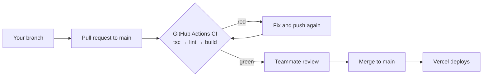

### 8.3 "I want to change…" cheat sheet

| I want to… | Edit | Watch out for |
| --- | --- | --- |
| Change text or colours on the feed | `app/meetups/page.tsx`, `components/feed/*` | Owned by Developer 1. |
| Add a campus building | `lib/locations.ts` **and** a new migration inserting into `campus_locations` | Both must match exactly or creation fails. |
| Add a category | `types/meetup.ts`, `lib/meetup-validation.ts`, `components/feed/categories.ts`, `components/map/map-config.ts`, **and** a migration for the DB `CHECK` | A shared contract: coordinate with the team. |
| Change a validation limit | `lib/meetup-validation.ts`, `app/meetups/new/actions.ts`, the form's `maxLength`, and a migration | Keep all layers in sync. |
| Change who can do what | A new SQL migration (RLS) | Needs care; run `supabase/verify.mjs` after. |
| Change the map look | `NEXT_PUBLIC_MAP_STYLE_URL` or `components/map/map-style.ts` | Use domain-restricted keys only. |
| Record a big decision | New file in `docs/adr/` from `template.md` | Changing an old decision needs a new ADR. |

### 8.4 Golden rules (from `AGENTS.md`)

- Components call `lib/` services, not Supabase directly.
- Never accept a `userId` from the browser. Always use the session.
- RLS is the real security; UI checks are just for a nicer experience.
- Meetup places only from `CAMPUS_LOCATIONS`. Never send or store a user's position.
- No service-role key anywhere in this app. Never commit `.env.local`.
- Conventional Commits (`feat:`, `fix:`, `docs:` …), small PRs, CI green before merging.

---

## 9. Learning path and FAQ

### 9.1 Suggested reading order

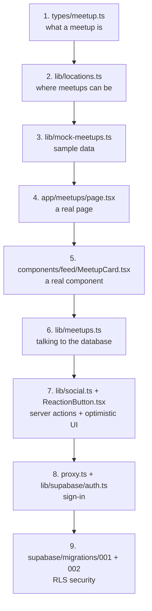

**Beginner exercises** (do them on a scratch branch, in mock mode):

1. Change the banner headline in `app/meetups/page.tsx` and watch the page update.
2. Add a fifth sample meetup in `lib/mock-meetups.ts`. It appears on both the feed and the map. Why? (Hint: both call `listMeetups()`.)
3. Change the `coffee` colour in `components/feed/categories.ts` and `components/map/map-config.ts`.
4. Read `validateCreateMeetupInput` and list every reason a meetup can be rejected.
5. Read the policies in `001_mvp.sql` and find the line that stops a host pecking their own meetup.

### 9.2 Reading a React component in 30 seconds

```tsx
"use client";                                   // runs in the browser (omit = runs on the server)

import { useState } from "react";               // bring in tools

export function Counter({ start }: { start: number }) {   // a component = a function; `start` is a "prop" (input)
  const [count, setCount] = useState(start);    // a remembered value that redraws the UI when changed
  return (
    <button onClick={() => setCount(count + 1)} className="rounded-xl bg-red-800 text-white">
      Clicked {count} times                     {/* HTML-like markup (JSX) with {code} inside */}
    </button>
  );
}
```

### 9.3 FAQ

**Why can I see meetups without signing in on my machine?** You're in mock mode (no Supabase settings). In live mode you'd be sent to `/login`.

**Why can't I peck the sample meetups?** Sample ids like `demo-coffee` aren't real database ids. Reactions need live mode.

**Why are times stored in UTC?** So everyone agrees on the exact moment. Each browser converts to its own timezone for display.

**Why doesn't the host have a peck row?** The host is always going, so `attendee_count` adds 1 automatically and the database blocks hosts from pecking.

**Why does the map need internet even in mock mode?** Map images come from OpenFreeMap.

**Why do we check things on the server if the form already checks them?** Anyone can skip the form and send requests directly. The browser is never trusted.

**Why "proxy.ts" and not "middleware.ts"?** Next.js 16 renamed it. Older tutorials say middleware.

**Where do I ask "why did we do X"?** `docs/adr/`. If it's not there and it matters, write an ADR.
